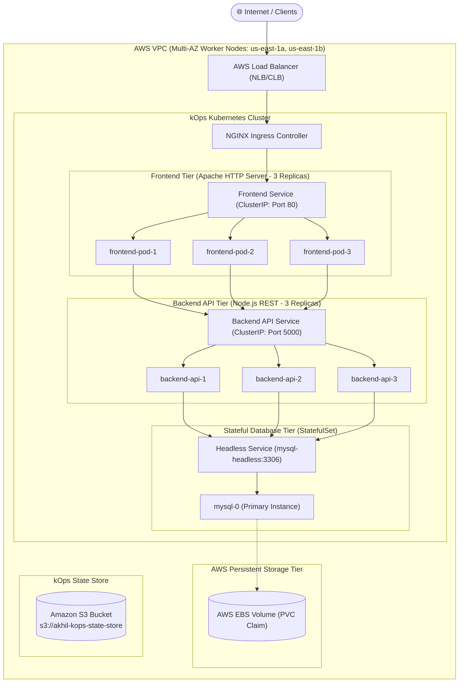

# ☸️ Production AWS Kubernetes Cluster via kOps
## High-Availability Multi-Tier Microservices Infrastructure on AWS EC2

[](https://kubernetes.io/)
[](https://aws.amazon.com/)
[](https://kops.sigs.k8s.io/)
[](#system-architecture)

---

## 📌 Executive Summary

This repository contains the complete infrastructure code, Kubernetes manifests, and operational automation for provisioning and operating an enterprise-grade, highly available Kubernetes cluster on **Amazon Web Services (AWS)** using **kOps (Kubernetes Operations)**.

The cluster hosts a multi-tier microservices application consisting of:
1. **Frontend Tier**: 3 Replicas of containerized Web UI (Apache HTTP Server) exposed via Ingress.
2. **Backend API Tier**: 3 Replicas of Node.js REST API microservices with internal CoreDNS service discovery.
3. **Database Tier**: Stateful MySQL 8.0 deployed via a **Kubernetes StatefulSet (`mysql-0`)** with persistent AWS EBS storage and headless service routing.

---

## 🏛️ System Architecture



---

## 📂 Repository Layout

```text
aws-kubernetes-kops-cluster/
├── README.md                           # Master project guide & architecture
├── docs/
│   ├── ARCHITECTURE.md                 # Deep-dive architectural design decisions
│   └── TROUBLESHOOTING.md              # L1/L2 Production incident runbook
├── k8s/
│   ├── 00-namespace.yaml               # Isolated production namespace
│   ├── 01-configmap-secret.yaml        # Externalized configs & Base64 secrets
│   ├── 02-mysql-statefulset.yaml       # MySQL StatefulSet + Headless Service + EBS PVC
│   ├── 03-backend-deployment.yaml      # Node.js API Deployment (3 Replicas) + ClusterIP
│   ├── 04-frontend-deployment.yaml     # React/Nginx Deployment (3 Replicas) + ClusterIP
│   └── 05-ingress.yaml                 # NGINX Ingress rules routing /api and /
└── scripts/
    ├── 01-create-cluster.sh            # Automated kOps cluster provisioning script
    ├── 02-validate-cluster.sh          # Readiness verification & node health check
    ├── 03-deploy-workloads.sh          # Ordered manifest deployment
    └── 04-teardown.sh                  # Clean cluster destruction script
```

---

## ⚡ Step-by-Step Provisioning Guide

### 1. Prerequisites & Tooling
Ensure your bastion operator machine has the required binaries:
```bash
# AWS CLI v2
aws --version

# kOps CLI
curl -Lo kops https://github.com/kubernetes/kops/releases/download/v1.28.0/kops-linux-amd64
chmod +x kops && sudo mv kops /usr/local/bin/

# kubectl
curl -LO "https://dl.k8s.io/release/v1.28.0/bin/linux/amd64/kubectl"
chmod +x kubectl && sudo mv kubectl /usr/local/bin/
```

### 2. S3 State Store & Environment Variables
kOps stores complete cluster state, certificates, and specifications in Amazon S3:
```bash
# Create state store bucket with encryption and versioning
aws s3api create-bucket \
    --bucket akhil-kops-state-store \
    --region us-east-1

aws s3api put-bucket-versioning \
    --bucket akhil-kops-state-store \
    --versioning-configuration Status=Enabled

export NAME=mycluster.k8s.local
export KOPS_STATE_STORE=s3://akhil-kops-state-store
```

### 3. Generate Cluster Configuration
```bash
kops create cluster \
    --name=${NAME} \
    --state=${KOPS_STATE_STORE} \
    --zones=us-east-1a,us-east-1b \
    --node-count=2 \
    --node-size=t3.medium \
    --master-size=t3.medium \
    --topology=public \
    --networking=calico
```

### 4. Build and Launch Infrastructure
```bash
# kOps provisions VPC, Subnets, Internet Gateways, Security Groups, ASGs, and EC2s
kops update cluster --name ${NAME} --yes --admin

# Wait for Control Plane and Nodes to transition to Ready
kops validate cluster --wait 10m
```

### 5. Deploy Multi-Tier Applications
Execute the ordered deployment script:
```bash
chmod +x scripts/*.sh
./scripts/03-deploy-workloads.sh
```

---

## 🎯 Key Architectural Decisions

| Decision | Implementation | Why it was chosen |
| :--- | :--- | :--- |
| **Cluster Orchestration** | Self-managed via **kOps** | Provides full transparency into control-plane topology, etcd clustering, and operating-system-level tuning on AWS. |
| **Database Workloads** | **StatefulSet** | Databases require stable persistent network identifiers (`mysql-0`), predictable boot ordering, and dedicated EBS volume bindings. |
| **Inter-Service Discovery** | **CoreDNS + Headless Service** | Decouples pods from ephemeral IPs; backend communicates directly with `mysql-headless.production.svc.cluster.local`. |
| **Storage Persistence** | **AWS EBS CSI (`gp3`)** | Delivers baseline 3,000 IOPS and 125 MB/s throughput independently of volume size, ensuring fast MySQL queries. |
| **High Availability** | **Multi-AZ Replicas** | Pods are distributed across `us-east-1a` and `us-east-1b` with Anti-Affinity rules to guarantee zero downtime during AZ outages. |

---

## 🔍 Day-2 Operations & Verification

```bash
# Verify cluster status
kops validate cluster

# Check all pods across the production namespace
kubectl get pods -n production -o wide

# Check Persistent Volume Claims
kubectl get pvc,pv -n production

# Verify Headless Service DNS
kubectl run dns-test --rm -it --image=busybox:1.28 -n production -- nslookup mysql-headless
```

---

## 🧹 Tear Down
To safely destroy all AWS infrastructure and stop billing:
```bash
./scripts/04-teardown.sh
```
